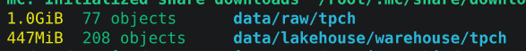
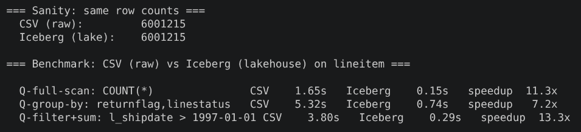

# TPC-H Data Lakehouse & Analytics Pipeline

An end-to-end containerized Data Lakehouse pipeline built with **Apache Spark**, **Apache Iceberg**, **MinIO (S3)**, and **dbt**:

```text
TPC-H DBGEN (CSV) ──▶ MinIO (s3a://raw/tpch) ──▶ Spark + Iceberg (s3a://lakehouse/warehouse) ──▶ dbt (tpch_mart)
```

## Repository Structure

```text
.
├── docker-compose.yml            # Service orchestration: minio, minio-init, spark, dbt
├── docker/                       # Dockerfiles & container dependencies
│   ├── Dockerfile.minio          # Builds MinIO server + mc client
│   ├── Dockerfile.spark          # Spark 3.5.5 + Iceberg 1.8.1 + Hadoop S3A JARs
│   ├── Dockerfile.dbt            # Python 3.11 + dbt-spark[PyHive]
│   └── requirements-dbt.txt
├── conf/                         # Spark configuration
│   ├── spark-defaults.conf       # Iceberg catalog (lakehouse) & MinIO S3A settings
│   └── log4j2.properties         # Spark JVM log verbosity control
├── scripts/                      # CLI entrypoints (sequential 1 → 3, or run_pipeline.sh)
│   ├── run_pipeline.sh           # Run the full end-to-end pipeline
│   ├── 1_generate_tpch.sh        # Step 1: Generate TPC-H CSVs with DBGEN
│   ├── 2_upload_minio.sh         # Step 2: Upload raw CSVs to MinIO (raw/tpch)
│   ├── 3_load_iceberg.sh         # Step 3: Load CSVs into Iceberg tables (lakehouse.tpch.*)
│   ├── spark_submit.sh           # Helper to run PySpark scripts inside the spark container
│   └── reset_clean.sh            # Wipe local data and restart the stack from a clean slate
├── spark/                        # PySpark application code
│   ├── session.py                # SparkSession factory
│   ├── tpch_schemas.py           # Explicit StructType schemas for all 8 TPC-H tables
│   ├── ingest/                   # Lakehouse ingestion & verification
│   │   ├── load_tables.py        # Initialize namespaces & load CSV → Iceberg
│   │   └── verify_tables.py      # Verify row counts against SF=1 expectations
│   ├── queries/                  # TPC-H analytical queries & data mart preview
│   │   ├── q01_pricing_summary.py
│   │   ├── q03_shipping_priority.py
│   │   ├── q10_returned_items.py
│   │   └── query_data_mart.py
│   └── benchmarks/               # Storage & partitioning performance benchmarks
│       ├── benchmark_csv_vs_iceberg.py
│       └── benchmark_partitioning.py
├── dbt/                          # SQL transformations & data quality tests (dbt-spark)
│   ├── dbt_project.yml           # dbt project configuration
│   ├── profiles.yml              # Spark Thrift Server connection (spark:10000)
│   └── models/
│       ├── sources.yml           # Source definitions for Iceberg tpch.* tables
│       ├── staging/              # stg_customer, stg_orders, stg_lineitem, stg_nation
│       └── marts/                # fct_customer_revenue + schema.yml (not_null & unique tests)
└── out/                          # Benchmark artifacts, screenshots & execution plans
```

---

## Quick Start

### 1. Start the Docker Stack
```bash
docker compose up -d --build
```
Active services:
- **MinIO**: S3 API at `http://localhost:9000`, Web Console at `http://localhost:9001` (`minio` / `minio123`)
- **Spark Thrift Server**: Port `10000`, Spark UI at `http://localhost:4040`
- **dbt**: Ready-to-use container for running SQL transformations and tests

### 2. Run the Full End-to-End Pipeline
```bash
./scripts/run_pipeline.sh 1
```
*(Replace `1` with any TPC-H Scale Factor, e.g. `10` for ~10 GiB / 86M+ rows).*

Or run each stage individually:
```bash
./scripts/1_generate_tpch.sh 1          # Generate CSVs into data/tpch
./scripts/2_upload_minio.sh             # Upload CSVs to MinIO (raw/tpch)
./scripts/3_load_iceberg.sh             # Load all 8 tables into Iceberg (lakehouse.tpch.*)
docker compose exec dbt dbt run         # Build staging & mart tables (lakehouse.tpch_mart.*)
docker compose exec dbt dbt test        # Run automated data quality tests
```

---

## Benchmark Results (SF=1 vs SF=10)

Evaluated locally in Docker on TPC-H **SF=1 (~8.6M rows / 1 GiB)** and **SF=10 (~86.6M rows / 10 GiB, ~60M `lineitem` rows)**. The full SF=10 end-to-end pipeline (`DBGEN → MinIO → Spark/Iceberg → dbt run & test`) completed in **13m 33s**.

| Metric | SF=1 (~8.6M rows) | SF=10 (~86.6M rows) | Notes |
| :--- | :---: | :---: | :--- |
| **Storage (CSV → Iceberg)** | `1.0 GiB` → `447 MiB` (**-56%**) | `10 GiB` → `2.8 GiB` (**-72%**) | Columnar Parquet compression in MinIO |
| **Q1: `COUNT(*)`** | `1.65s` → `0.15s` (**11.3x**) | `11.25s` → `0.11s` (**101.0x**) | Metadata-only count from Iceberg manifests |
| **Q2: `GROUP BY` (2 cols)** | `5.32s` → `0.74s` (**7.2x**) | `48.49s` → `3.42s` (**14.2x**) | Column pruning (reads 2 of 16 columns) |
| **Q3: `FILTER + SUM`** | `3.80s` → `0.29s` (**13.3x**) | `56.62s` → `1.01s` (**56.0x**) | Predicate pushdown & Parquet min/max stats |
| **Hidden Partitioning (`years`)** | `0.43s` → `0.11s` (**4.1x**) | `1.16s` → `0.12s` (**9.9x**) | Near-constant ~0.12s latency at 10x scale |

### SF=10 Benchmark Evidence (60M `lineitem` rows)

**1. Storage Reduction: Raw CSV (`10 GiB`) vs Iceberg/Parquet (`2.8 GiB`)**


**2. Query Speedup: Raw CSV vs Iceberg**


**3. Partition Pruning: Unpartitioned vs `years(l_shipdate)`**


<details>
<summary><b>View SF=1 Benchmarks & Spark Physical Plan Comparison</b></summary>

#### SF=1 Benchmark (6M `lineitem` rows)




#### Physical Plan Comparison (Partition Pruning)
On the **Unpartitioned** table, Spark must execute a `Filter` operator after `BatchScan`:


On the **Partitioned (`years(l_shipdate)`)** table, the `Filter` operator is completely eliminated via Iceberg partition pruning:


</details>

---

## Verification, Queries & Benchmarking

```bash
# Test dbt connection to Spark Thrift Server
docker compose exec dbt dbt debug

# Verify row counts for all 8 TPC-H tables (SF=1)
./scripts/spark_submit.sh ingest/verify_tables.py

# Preview the dbt Data Mart (lakehouse.tpch_mart.fct_customer_revenue)
./scripts/spark_submit.sh queries/query_data_mart.py

# Run TPC-H analytical queries (Q1 / Q3 / Q10)
./scripts/spark_submit.sh queries/q01_pricing_summary.py

# Run CSV vs Iceberg and Unpartitioned vs Partitioned benchmarks
./scripts/spark_submit.sh benchmarks/benchmark_csv_vs_iceberg.py
./scripts/spark_submit.sh benchmarks/benchmark_partitioning.py

# Generate and serve dbt Docs at http://localhost:8080
docker compose exec dbt dbt docs generate
docker compose exec dbt dbt docs serve --host 0.0.0.0 --port 8080
```

## Reset Environment
To wipe all local MinIO and CSV data and restart the stack from scratch:
```bash
./scripts/reset_clean.sh
```

---

## Team Members
| Student ID | Name |
| :--- | :--- |
| 13522080 | Julian Chandra Sutadi |
| 13523031 | Rafen Max Alessandro |
| 13523135 | Ahmad Syafiq |

## AI / LLM Usage Declaration
This project was developed with assistance from AI / Large Language Models (LLMs):
* **GitHub Copilot** - Initial project scaffolding and implementation.
* **Antigravity** - End-to-end pipeline debugging, repository restructuring, and documentation.

## External Reference
* [Hands-On with Apache Iceberg on Your Laptop: Deep Dive with Apache Spark, Nessie, MinIO, and More (HackerNoon)](https://hackernoon.com/hands-on-with-apache-iceberg-on-your-laptop-deep-dive-with-apache-spark-nessie-minio-and-more)
