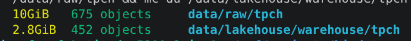
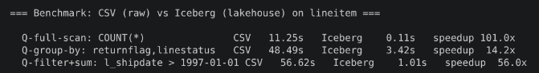
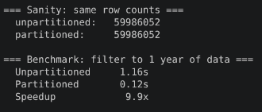
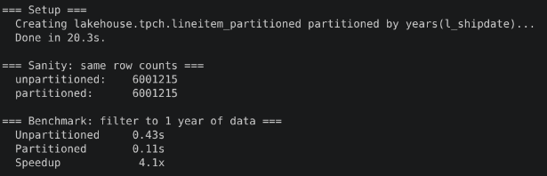
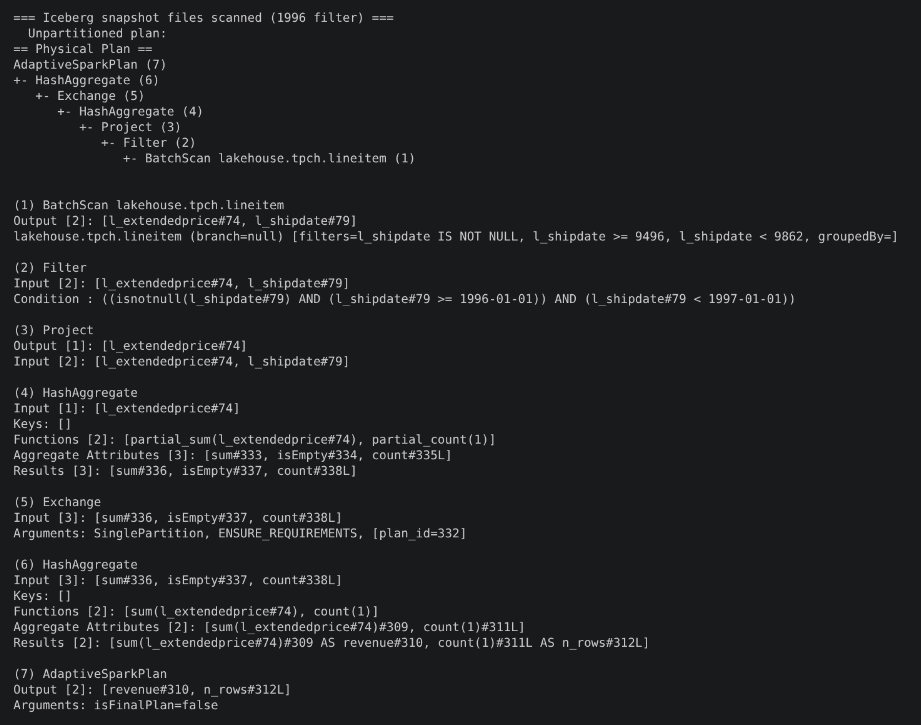
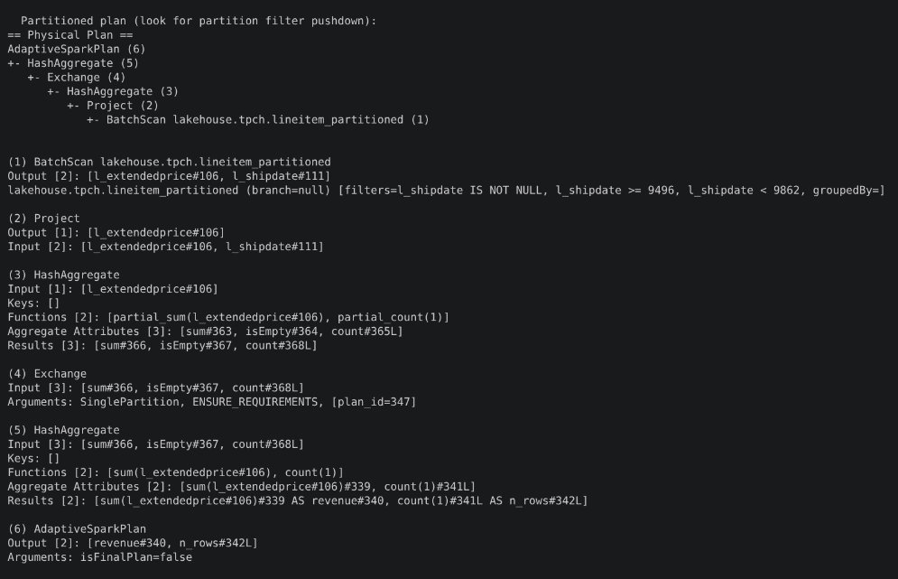

# Proyek Big Data: TPC-H Lakehouse & Data Mart

Pipeline Big Data end-to-end berbasis **Apache Spark + Apache Iceberg + MinIO + dbt**:

```
TPC-H DBGEN (CSV) ──▶ MinIO (s3a://raw/tpch) ──▶ Spark + Iceberg (s3a://lakehouse/warehouse) ──▶ dbt (tpch_mart)
```

## Struktur Repositori

```text
.
├── docker-compose.yml            # Orkestrasi service: minio, minio-init, spark, dbt
├── docker/                       # Semua Dockerfile & dependency container
│   ├── Dockerfile.minio          # Build MinIO server + mc client
│   ├── Dockerfile.spark          # Spark 3.5.5 + Iceberg 1.8.1 + Hadoop S3A jars
│   ├── Dockerfile.dbt            # Python 3.11 + dbt-spark[PyHive]
│   └── requirements-dbt.txt
├── conf/                         # Konfigurasi Spark
│   ├── spark-defaults.conf       # Catalog Iceberg (lakehouse) & koneksi MinIO S3A
│   └── log4j2.properties         # Pengaturan log level Spark
├── scripts/                      # Entrypoint CLI (berurutan 1 → 3, atau run_pipeline.sh)
│   ├── run_pipeline.sh           # Jalankan seluruh pipeline end-to-end
│   ├── 1_generate_tpch.sh        # Step 1: Generate CSV TPC-H dengan DBGEN
│   ├── 2_upload_minio.sh         # Step 2: Upload CSV ke MinIO (raw/tpch)
│   ├── 3_load_iceberg.sh         # Step 3: Load CSV ke tabel Iceberg (lakehouse.tpch.*)
│   ├── spark_submit.sh           # Helper untuk menjalankan script PySpark di container spark
│   └── reset_clean.sh            # Hapus semua data & restart container dari awal
├── spark/                        # Kode PySpark
│   ├── session.py                # Factory SparkSession
│   ├── tpch_schemas.py           # Definisi StructType untuk 8 tabel TPC-H
│   ├── ingest/                   # Load & verifikasi data ke Iceberg
│   │   ├── load_tables.py        # Inisialisasi schema & load CSV → Iceberg
│   │   └── verify_tables.py      # Cek row count vs ekspektasi SF=1
│   ├── queries/                  # Query analitik TPC-H & preview data mart
│   │   ├── q01_pricing_summary.py
│   │   ├── q03_shipping_priority.py
│   │   ├── q10_returned_items.py
│   │   └── query_data_mart.py
│   └── benchmarks/               # Benchmark performa storage & partitioning
│       ├── benchmark_csv_vs_iceberg.py
│       └── benchmark_partitioning.py
├── dbt/                          # Transformasi & data quality test (dbt-spark)
│   ├── dbt_project.yml           # Konfigurasi project dbt
│   ├── profiles.yml              # Koneksi ke Spark Thrift Server (spark:10000)
│   └── models/
│       ├── sources.yml           # Referensi tabel Iceberg di schema tpch
│       ├── staging/              # stg_customer, stg_orders, stg_lineitem, stg_nation
│       └── marts/                # fct_customer_revenue + schema.yml (not_null & unique test)
└── out/                          # Hasil output benchmark (grafik & execution plan)
```

---

## Quick Start

### 1. Jalankan Infrastruktur Docker
```bash
docker compose up -d --build
```
Service yang aktif:
- **MinIO**: API di `http://localhost:9000`, Console di `http://localhost:9001` (`minio` / `minio123`)
- **Spark Thrift Server**: Port `10000`, Spark UI di `http://localhost:4040`
- **dbt**: Container siap pakai untuk menjalankan transformasi & test

### 2. Jalankan Seluruh Pipeline (End-to-End)
```bash
./scripts/run_pipeline.sh 1
```
(Ganti `1` dengan Scale Factor lain, misal `10` untuk ~10GB).

Atau jalankan per tahap:
```bash
./scripts/1_generate_tpch.sh 1          # Generate CSV ke data/tpch
./scripts/2_upload_minio.sh             # Upload CSV ke MinIO bucket raw/tpch
./scripts/3_load_iceberg.sh             # Load semua tabel ke Iceberg (lakehouse.tpch.*)
docker compose exec dbt dbt run         # Build staging & data mart (lakehouse.tpch_mart.*)
docker compose exec dbt dbt test        # Jalankan data quality test
```

---

## Hasil Benchmark & Evaluasi (SF=1 vs SF=10)

Evaluasi dijalankan pada dataset TPC-H skala **SF=1 (~8,6 juta baris / 1 GiB)** dan **SF=10 (~86,6 juta baris / 10 GiB, ~60 juta baris `lineitem`)** secara lokal menggunakan Docker. Pipeline end-to-end SF=10 (`DBGEN → MinIO → Spark/Iceberg → dbt run & test`) selesai dalam **13 menit 33 detik**.

| Metrik | SF=1 (~8,6M rows) | SF=10 (~86,6M rows) | Catatan |
| :--- | :---: | :---: | :--- |
| **Storage (CSV → Iceberg)** | `1.0 GiB` → `447 MiB` (**-56%**) | `10 GiB` → `2.8 GiB` (**-72%**) | Kompresi kolumnar Parquet di MinIO |
| **Q1: `COUNT(*)`** | `1.65s` → `0.15s` (**11.3x**) | `11.25s` → `0.11s` (**101.0x**) | Metadata-only count dari manifest Iceberg |
| **Q2: `GROUP BY` (2 kolom)** | `5.32s` → `0.74s` (**7.2x**) | `48.49s` → `3.42s` (**14.2x**) | Column pruning (membaca 2 dari 16 kolom) |
| **Q3: `FILTER + SUM`** | `3.80s` → `0.29s` (**13.3x**) | `56.62s` → `1.01s` (**56.0x**) | Predicate pushdown & statistik min/max Parquet |
| **Hidden Partitioning (`years`)** | `0.43s` → `0.11s` (**4.1x**) | `1.16s` → `0.12s` (**9.9x**) | Latency tetap ~0.12s meski data naik 10x |

### Bukti Benchmark SF=10 (60M baris `lineitem`)

**1. Storage Reduction: Raw CSV (`10 GiB`) vs Iceberg/Parquet (`2.8 GiB`)**


**2. Query Speedup: Raw CSV vs Iceberg**


**3. Partition Pruning: Unpartitioned vs `years(l_shipdate)`**


<details>
<summary><b>Lihat Detail Hasil SF=1 & Perbandingan Spark Physical Plan</b></summary>

#### Benchmark SF=1 (6M baris `lineitem`)




#### Perbandingan Physical Plan (Partition Pruning)
Pada tabel **Unpartitioned**, Spark tetap menjalankan operator `Filter` setelah `BatchScan`:


Pada tabel **Partitioned (`years(l_shipdate)`)**, operator `Filter` hilang sepenuhnya karena sudah di-prune di level partisi Iceberg:


</details>

---

## Verifikasi, Query & Benchmarking

```bash
# Cek koneksi dbt ke Spark Thrift Server
docker compose exec dbt dbt debug

# Verifikasi row count 8 tabel TPC-H (SF=1)
./scripts/spark_submit.sh ingest/verify_tables.py

# Preview hasil Data Mart (lakehouse.tpch_mart.fct_customer_revenue)
./scripts/spark_submit.sh queries/query_data_mart.py

# Jalankan query TPC-H (Q1 / Q3 / Q10)
./scripts/spark_submit.sh queries/q01_pricing_summary.py

# Benchmark CSV vs Iceberg & Unpartitioned vs Partitioned
./scripts/spark_submit.sh benchmarks/benchmark_csv_vs_iceberg.py
./scripts/spark_submit.sh benchmarks/benchmark_partitioning.py

# Generate & buka dbt Docs di http://localhost:8080
docker compose exec dbt dbt docs generate
docker compose exec dbt dbt docs serve --host 0.0.0.0 --port 8080
```

## Reset Environment
Untuk menghapus semua data MinIO & CSV lokal lalu memulai ulang dari awal:
```bash
./scripts/reset_clean.sh
```

---

## Anggota Tim
| NIM | Nama |
| :--- | :--- |
| 13522080 | Julian Chandra Sutadi |
| 13523031 | Rafen Max Alessandro |
| 13523135 | Ahmad Syafiq |

## Deklarasi Penggunaan AI / LLM
Proyek ini dikembangkan dengan bantuan AI / Large Language Models (LLM):
* **GitHub Copilot** - Menyusun struktur dan implementasi awal proyek.
* **Antigravity** - Debugging, perbaikan pipeline end-to-end, dan perapihan struktur repositori.

## Referensi Eksternal
* [Hands-On with Apache Iceberg on Your Laptop: Deep Dive with Apache Spark, Nessie, MinIO, and More (Hackernoon)](https://hackernoon.com/hands-on-with-apache-iceberg-on-your-laptop-deep-dive-with-apache-spark-nessie-minio-and-more)
